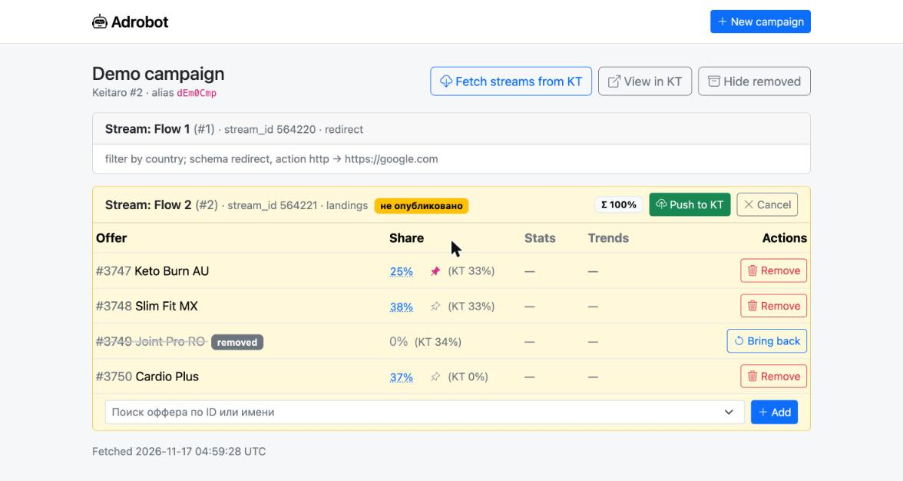
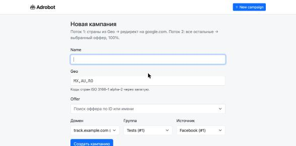

# Adrobot

Обёртка над трекером [Keitaro](https://keitaro.io): создаёт готовые кампании и редактирует офферы в потоках
через локальный черновик с публикацией в Keitaro по кнопке.

- **Создаватор** — название + гео + оффер → кампания с доменом/группой/источником и двумя потоками
  (гео → `https://google.com`, остальные → оффер 100%).
- **Редактор** — Fetch / Add / Remove / Bring back / Pin / ручной вес / Push / Cancel, архив удалённых офферов,
  «жёлтые» неопубликованные потоки — как в демо-видео.





Стек: FastAPI, SQLAlchemy 2.0 + Alembic (SQLite), httpx, Jinja2 + Bootstrap 5 + jQuery + Select2.

## Запуск

Нужен [uv](https://docs.astral.sh/uv/). Python ставится сам (≥ 3.12).

```bash
cp .env.example .env     # по умолчанию смотрит на встроенный mock Keitaro
make dev                 # app на http://127.0.0.1:8000 + mock на http://127.0.0.1:8100
```

Или через Docker: `docker compose up --build`. `.env`, `*.db` и `.venv` в образ не попадают (`.dockerignore`).

Mock Keitaro — `http://127.0.0.1:8100/mock`: состояние «трекера», кнопки «Удалить оффер в KT» (сценарий 4:11
из видео) и «Reset seed». В сиде кампания #2 как в видео: Flow 1 (AU → google.com), Flow 2 (3 оффера 33/33/34).

### С реальным Keitaro

```bash
# .env
KEITARO_URL=https://your-tracker.example
KEITARO_API_KEY=...            # Keitaro → Обслуживание → Пользователи → Admin API keys
DEFAULT_DOMAIN_ID=...          # предвыбор в форме создания
DEFAULT_GROUP_ID=...
DEFAULT_TRAFFIC_SOURCE_ID=...
```

```bash
make probe         # только GET: справочники, формат потоков
make probe-write   # + временная кампания adrobot-probe-*, проверка PUT, удаление
make e2e-real      # сценарий из видео на временной кампании adrobot-probe-e2e-*, удаление
make app           # только приложение, без mock
```

### Тесты

```bash
make test
```

Тесты гоняются в GitHub Actions (`.github/workflows/tests.yml`) на каждый push и PR.

- `tests/test_weights.py` — функция весов: кейсы из ТЗ (100/3 → 34+33+33, pinned 25 → 25+38+37, …)
  и property-тесты на hypothesis (сумма всегда 100, pinned не меняются, разброс ≤ 1).
- `tests/test_editor_scenario.py` — сценарий из видео шаг за шагом через HTTP API против mock + краевые случаи.
- `tests/test_creator.py` — создание, валидация, откат кампании при ошибке потока, коллизия alias.
- `tests/test_migrations.py` — миграции Alembic совпадают с моделями.

## Как устроено

```
routers (pages.py — HTML, api.py — JSON/фрагменты)
   └─ services: creator · editor · sync (Fetch) · weights (чистая функция)
        └─ keitaro.py (httpx-клиент, TTL-кэш офферов)  +  models.py (SQLAlchemy)
```

Keitaro не умеет черновики, закрепление весов и архив, поэтому для каждой связки «поток–оффер»
(`stream_offers`) храним текущий черновик (`state`, `share`, `pinned`, `is_new`) и последнее опубликованное
(`published_state`, `published_share`). Поток «жёлтый», если они расходятся, — это вычисляется, а не хранится.

Каждая мутация в редакторе возвращает перерисованную карточку потока; jQuery подменяет её на странице.
Ошибки бизнес-правил → 400, конфликт → 409, ошибки Keitaro → 502 с текстом трекера; фронт показывает тост.

## Проверено на реальном API

17.11.2026, тестовый Keitaro из задания: `make probe-write` (временная кампания `adrobot-probe-*`) и `make e2e-real`
(сценарий из видео через наши сервисы на кампании `adrobot-probe-e2e-*`). Обе кампании удалены скриптами.

| Вопрос | Результат |
|---|---|
| `PUT /streams/{id}` с одним `offers` не трогает остальное? | Да: фильтры, схема, action на месте (только `null` → `""` у `action_payload`/`comments`) |
| `offers` в PUT заменяет список целиком? | Да — removed исчезают из потока |
| `action_type` редиректа | `http` (HttpRedirect, 302), есть в `/streams_actions` |
| Фильтр гео | `{"name": "country", "mode": "accept", "payload": ["AU", "MX"]}` — принят как есть |
| Keitaro проверяет сумму весов? | **Нет.** Принимает 90%, пустой список и выключенные с любым весом → проверки до Push делаем сами |
| Порядок `offers` после PUT | **Не сохраняется** (отправили [a, b], получили [b, a]) → порядок в UI храним у себя; mock это повторяет |
| `DELETE /campaigns/{id}` | После него `GET` → 404 |
| Сценарий из видео | 3 → 4×25 → Remove (34/33/33) → Bring back → удаление 2 офферов в KT + Fetch (50/50, жёлтый) → pin 25 + Bring back → 25/38/37 в Keitaro. Гео-поток после всех PUT не изменился |

## Решения и допущения

- **Округление весов.** `R = 100 − Σpinned` делится поровну, остаток по +1 получают первые незакреплённые
  в порядке потока (порядок из Keitaro, новые — в конец). Отсюда 75 на 2 → 38+37.
- **Пересчёт стабилен:** если незакреплённые уже поделены поровну (сумма верная, разброс ≤ 1), их не трогаем.
  Закрепить и открепить вес у 33/33/34 — это не изменение, поток не желтеет.
- **Ручной ввод веса закрепляет его** и пересчитывает остальные. Сумма закреплённых > 100 → 400, ничего не
  меняется. Если закреплены все и сумма ≠ 100 — такое состояние допустимо, но Push заблокирован (Σ красная).
- **Remove и Bring back снимают закрепление**; закрепить удалённый оффер нельзя. Bring back возвращает оффер
  на прежнее место в списке, а не в конец.
- **Закрепление относится к значению.** Если после Fetch или Cancel вес оффера стал другим (в Keitaro другое
  число, черновик отброшен), закрепление снимается — закреплённое число не меняется молча.
- **Add уже удалённого оффера = Bring back**; Add активного → ошибка «уже в потоке». В автокомплите
  активные офферы потока скрыты.
- **Push защищён от гонки:** перед `PUT` поток перечитывается из Keitaro и сравнивается с последним
  опубликованным снимком. Если поток поменяли в трекере после Fetch — 409 «нажмите Fetch», ничего не затираем.
- **Пустой поток не публикуется:** если удалены все офферы, Push заблокирован с объяснением.
- **Push отправляет только `offers`** (список заменяется целиком → removed исчезают из Keitaro),
  затем перечитывает поток и делает его опубликованным состоянием.
- **Выключенные в Keitaro офферы** (`state=disabled`) трафик не получают: они не входят в 100%, их вес и
  состояние уходят в Keitaro как были, менять вес и закреплять их нельзя (бейдж «disabled in KT»).
  Keitaro сумму не проверяет вообще (см. ниже), так что правило «100% среди получающих трафик» — наше.
- **Fetch сбрасывает черновики** (источник правды — Keitaro); если есть неопубликованные изменения,
  сначала спрашиваем в модалке. Удалённые в Keitaro офферы становятся `removed` с Bring back, а не исчезают.
  Потоки, удалённые в Keitaro (`state=deleted`), удаляются локально.
  Если после Fetch сумма ≠ 100 (например, офферы удалили прямо в трекере), веса сразу пересчитываются в
  черновик — поток жёлтый, остаётся нажать Push.
- **409 при Push** ничего не отправляет и прямо пишет, что Fetch сбросит черновик этого потока.
- **Офферы добавляются только в потоки со схемой `landings`** (или где офферы уже есть).
- **Гео:** разделители — запятая, пробел, `;`; регистр не важен; дубли схлопываются; коды проверяются по
  ISO 3166-1 alpha-2 (`pycountry`), поэтому `UK` — ошибка, нужен `GB`.
- **Создаватор:** всё (имя, гео, оффер, домен/группа/источник) проверяется до первого запроса на запись.
  Alias — 7 символов `[A-Za-z0-9]`, при коллизии до 3 попыток. Любая ошибка после создания кампании →
  `DELETE /campaigns/{id}`; если и он не удался — пользователь видит, какую кампанию удалить руками.
- **Stats / Trends** — колонки есть, но пустые: в демо они тоже пустые, в ТЗ не требуются.
- **«Show all offers»** в их UI трактуется как переключатель видимости архивных (removed) офферов.
- `cost_currency` не передаётся — Keitaro берёт валюту из настроек трекера.

## Как использовался AI

Разработка велась в Claude Code: разбор ТЗ и видео-таймкодов, брейншторм дыр в ТЗ
(`docs/plans/2026-11-17-adrobot-design.md`), сверка с OpenAPI-спекой Keitaro, генерация кода и тестов,
прогон UI в браузере (Claude in Chrome). Все решения о поведении проверены тестами, цифры весов —
юнит- и property-тестами.
